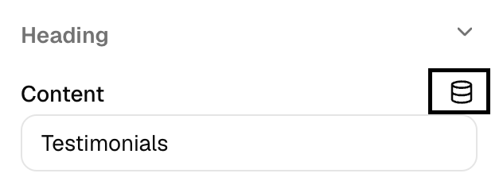

# Data Connectors

Connect your components to dynamic data from your Shopify store - product titles, prices, collection names, and more. Update once in the visual editor, and your content stays fresh automatically.

## Using Data Connectors in Studio

<Note>
No coding required! Click the database icon above any text field to visually select your data source.
</Note>

<Frame>
  <video
    autoPlay
    muted
    loop
    playsInline
    src="https://cdn.shopify.com/videos/c/o/v/59cbe901dbf44f45a3e164839e2036ec.mp4"
  >
    Your browser does not support the video tag.
  </video>
</Frame>

### How It Works

1. **Click the database icon** above any text, textarea, or richtext field

<Frame>
  
</Frame>

2. **Browse available data** from your store (products, collections, pages, shop info)
3. **Select what you need** - we'll generate the code automatically
4. **See it live** - preview updates instantly

<Frame>
  
</Frame>

### Example: Product Title

Instead of typing code, just:
- Click the database icon
- Navigate: **Current Page** → **Product** → **Title**
- Done! The product title appears automatically

<Frame>
  
</Frame>

### Available Data Sources

**Shop Data**: Store name, currency, domain (from root loader)

**Current Page**: Product/collection/page details for the active page (from route loaders)

**Route Data**: Specific page routes in your theme (from route loaders)

**Custom Data**: Any data you return from your loader functions - third-party APIs, custom integrations, computed values

<Frame>
  
</Frame>

## How Data Connectors Work

Data connectors pull information from your Hydrogen/React Router **loader functions**. This means developers can customize what data is available by modifying loaders.

### Adding Custom Data Sources

Want to connect to third-party APIs? Just add the data to your route loader:

```tsx
// app/routes/products/product.tsx (route id "routes/products/product")
export async function loader({ params }: LoaderFunctionArgs) {
  let product = await getProduct(params.productHandle)

  // Add custom data from any API
  let reviews = await fetch(`https://reviews-api.com/product/${params.productHandle}`)
    .then(res => res.json())

  let customData = await fetch('https://your-api.com/data')
    .then(res => res.json())

  return {
    product,
    reviews,        // Now available in Studio!
    customData      // This too!
  }
}
```

Once you add data to your loader, **it automatically appears in Weaverse Studio's data selector** - no extra configuration needed. Users can then visually bind to `{{routes/products/product.reviews.rating}}` or `{{routes/products/product.customData.value}}` without writing code.

### Where Data Comes From

| Loader Type | Studio Path | Example |
|-------------|-------------|---------|
| Root loader | `root.*` | `{{root.layout.shop.name}}` |
| Route loader | `routes/[route].*` | `{{routes/products/product.product.title}}` |
| Custom loader data | `routes/[route].*` | `{{routes/products/product.yourCustomData}}` |

<Tip>
Any data returned from your loader functions is automatically available in the visual data selector. Add third-party integrations, custom APIs, or computed data - users can bind to it instantly.
</Tip>

## Template Syntax (For Developers)

<Note>
Using Studio's visual interface? Skip this section - the syntax is auto-generated for you.
</Note>

Data connectors use `{{path}}` syntax to reference data:

```html
<!-- Shop info -->
{{root.layout.shop.name}}

<!-- Product data -->
{{routes/products/product.product.title}}
{{routes/products/product.product.price}}

<!-- Images -->
{{routes/products/product.product.images[0].url}}

<!-- Collection -->
{{routes/collections/collection.collection.title}}
```

### Data Source Patterns

| Pattern | Use For | Example |
|---------|---------|---------|
| `root.*` | Global shop data | `{{root.layout.shop.currency}}` |
| `routes/products/product.*` | Product pages | `{{routes/products/product.product.title}}` |
| `routes/collections/collection.*` | Collection pages | `{{routes/collections/collection.collection.title}}` |

### Route IDs

A `routes/...` path starts with the React Router route id: the route module's path under `app/`, without the extension, as registered in `app/routes.ts`. URL params and the `:locale?` prefix don't appear in it. In Pilot:

```html
<!-- Homepage -->
{{routes/home.weaverseData.page.title}}

<!-- Blog article -->
{{routes/blogs/article.article.title}}

<!-- Product -->
{{routes/products/product.product.price}}
```

## Using in Component Code

Add data connectors to your component schema:

```tsx
import { createSchema } from '@weaverse/hydrogen/react-router'

export let schema = createSchema({
  type: 'product-card',
  title: 'Product Card',
  settings: [
    {
      group: 'Content',
      inputs: [
        {
          type: 'text',
          name: 'title',
          label: 'Product Title',
          defaultValue: '{{routes/products/product.product.title}}'
        },
        {
          type: 'text',
          name: 'price',
          label: 'Price',
          defaultValue: '${{routes/products/product.product.price}}'
        },
        {
          type: 'richtext',
          name: 'description',
          label: 'Description',
          defaultValue: '{{routes/products/product.product.description}}'
        }
      ]
    }
  ]
})
```

Then use in your component:

```tsx
function ProductCard({ ref, title, price, description, ...rest }: ProductCardProps) {
  return (
    // Spread the remaining props so Studio can select the section
    <div ref={ref} {...rest} className="product-card">
      <h3>{title}</h3>
      <p className="price">{price}</p>
      <div dangerouslySetInnerHTML={{ __html: description }} />
    </div>
  )
}
```

## Extending with Third-Party Data

### Example: Adding Product Reviews

```tsx
// app/routes/products/product.tsx (route id "routes/products/product")
import { getProduct } from '~/lib/shopify'
import { getProductReviews } from '~/lib/reviews.server'

export async function loader({ params }: LoaderFunctionArgs) {
  let product = await getProduct(params.productHandle)

  // Fetch reviews through a server-only integration adapter.
  // The adapter owns vendor authentication and response mapping.
  let reviewsData = await getProductReviews(product.id)

  return {
    product,
    reviews: {
      average: reviewsData.average_rating,
      count: reviewsData.total_reviews,
      items: reviewsData.reviews
    }
  }
}
```

Now in Studio, users can visually select:
- `{{routes/products/product.reviews.average}}` → Shows "4.5"
- `{{routes/products/product.reviews.count}}` → Shows "127 reviews"
- `{{routes/products/product.reviews.items[0].text}}` → First review text

No code required for users - they just click and select from the visual interface.

For a complete server-side implementation, see [Integrate Judge.me Reviews with Shopify Hydrogen](/hydrogen-integrations/judgeme-reviews).

### Example: Adding Custom API Data

```tsx
// app/routes/home.tsx (route id "routes/home")
export async function loader() {
  // Fetch from your backend, CMS, or any API
  let announcement = await fetch('https://your-cms.com/announcement')
    .then(res => res.json())

  let featuredContent = await fetch('https://your-api.com/featured')
    .then(res => res.json())

  return {
    weaverseData: await getWeaverseData(),
    announcement,      // Available as {{routes/home.announcement.text}}
    featuredContent    // Available as {{routes/home.featuredContent.title}}
  }
}
```

## Quick Tips

### ✅ Best Practices

```html
<!-- Use specific paths -->
{{routes/products/product.product.title}}

<!-- Not generic ones -->
{{product.title}}
```

### 🐛 Troubleshooting

**Data not showing?**
- Check the path exists on that page type
- Verify you're on the correct page (e.g., product page for product data)
- Use Studio's visual picker to verify the correct path

**Seeing `{{...}}` in output?**
- The data path doesn't exist or isn't loaded yet
- Check your route matches the data source

### 🔒 Security

Data connectors automatically sanitize output to prevent XSS attacks. Your content is safe.

## Related Docs

- [Component Schema](/development-guide/component-schema) - Define component settings
- [Input Settings](/development-guide/input-settings) - Configure input types
- [Creating Components](/development-guide/creating-components) - Build components
