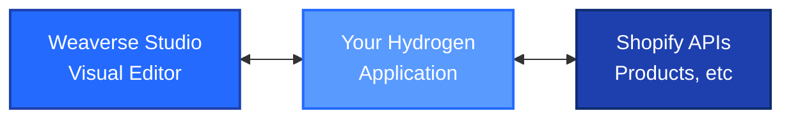

# How Weaverse Works

Weaverse is a visual page builder for Shopify Hydrogen and other supported Shopify headless storefronts. Developers set up the storefront and its Weaverse integration; merchants then edit the content and layouts exposed by that integration in Weaverse Studio.

<Warning>
  **Headless storefronts only, not Liquid themes.** Weaverse does not build or edit Shopify Online Store Liquid themes. Installing the app does not convert an existing Liquid theme into a Hydrogen storefront or make that theme editable in Weaverse Studio.
</Warning>

## Supported Storefronts

- **Shopify Hydrogen:** a Hydrogen storefront with the Weaverse integration, such as a project based on Pilot.
- **Next.js App Router:** a Shopify headless storefront using the supported `@weaverse/next` integration. See the [Next.js integration guide](/nextjs/overview).

A Shopify store is still required for commerce data. The storefront being edited must run the relevant Weaverse integration. A Shopify store with only a Liquid theme is not a supported editing environment.

## Shopify Store Domain vs. Studio Preview URL

These addresses serve different purposes:

- **Shopify store domain:** `your-store.myshopify.com` identifies the Shopify store used for commerce data. It is not the headless application's preview address. The storefront served at this address normally belongs to Shopify's Liquid-based Online Store.
- **Studio preview URL:** the address of your running, Weaverse-integrated headless application. For the local Hydrogen quickstart, this is `http://localhost:3456`. For a hosted setup, use the actual deployed application's URL.

The headless storefront can be connected to the same Shopify store while running at a different URL. Pointing Studio at a Liquid storefront does not add the Weaverse integration to it.

## What the Shopify App Does

The Shopify app connects your store to the Weaverse project workflow. Creating a project and installing the app are not substitutes for setting up a compatible headless storefront. Weaverse Studio edits the registered components and content in that storefront, not the Liquid theme under **Online Store > Themes**.

## Set Up and Verify Your Headless Storefront

1. **Use a supported storefront.** Follow the [Hydrogen quickstart](/intro/quickstart) to set up a Weaverse-integrated storefront, or connect an existing storefront with the appropriate Weaverse integration. A store using only a Liquid theme is not enough.
2. **Confirm the headless application loads.** Open its preview URL directly. If testing on another machine, use a reachable hosted preview; `localhost` refers to the machine running the browser.
3. **Connect Studio to that application.** Open the corresponding Weaverse project. If Studio shows **Preview Connection Lost**, use **Manage previews** to check that the selected URL belongs to the running headless application, not the store's Liquid storefront.
4. **Verify visual editing.** Open a page containing Weaverse sections, select a section, change an available content setting, and confirm the change appears in Studio's preview. Use the project's normal save and publish workflow to verify the result on that headless storefront.
5. **Check the correct output.** The expected result is on the connected headless storefront. The store's separate Liquid theme is not the output of this workflow.

**If the preview still fails:** an incorrect storefront URL is one possible cause, not the only one. A stopped application, an incomplete integration, or embedding restrictions can also prevent Studio from connecting. Follow [Preview Connection Errors](/troubleshooting/preview-errors) rather than treating every connection error as proof of a Liquid-theme setup.

<Note>
  This page uses the React Router adapter, `@weaverse/hydrogen`, in its examples. Weaverse also supports Hydrogen storefronts on the Next.js App Router through `@weaverse/next`: the Studio workflow and component schemas are the same, while routes load pages through a request-scoped server client. See [how the Next.js integration differs](/nextjs/overview).
</Note>

## Architecture Overview



## The Weaverse Workflow

### 1. Developer Experience

**Code Components Once**
```tsx
// app/sections/product-card/index.tsx
// You write React components with schemas
import { createSchema, type HydrogenComponentProps } from '@weaverse/hydrogen'

interface ProductCardProps extends HydrogenComponentProps {
  title: string
  price: string
}

function ProductCard({ ref, title, price, ...rest }: ProductCardProps) {
  return <div ref={ref} {...rest}>{title} - {price}</div>
}

export default ProductCard

export const schema = createSchema({
  type: 'product-card',
  title: 'Product Card',
  settings: [/* configuration */],
})
```

**Register Components**

Each component module is imported as a namespace (so Weaverse can read both the
default export and its `schema`) and added to the `components` array in
`app/weaverse/components.ts`:

```ts
// app/weaverse/components.ts
import type { HydrogenComponent } from '@weaverse/hydrogen'
import * as ProductCard from '~/sections/product-card'

export const components: HydrogenComponent[] = [ProductCard]
```

### 2. Merchant Experience

**Visual Editing**
- Merchants drag components onto pages
- Real-time preview across all devices  
- Intuitive settings panels for customization
- No code required

**Content Management**
- Create and manage pages visually
- Organize content with sections and components
- Preview changes before publishing

### 3. Runtime Performance

**No Page-Builder Runtime for Shoppers**
- Pages are server-rendered by Hydrogen on each request, using the page data loaded from Weaverse
- The Studio editing bridge only loads in design mode, not on the live storefront
- Only your component logic ships to browsers

**Optimized Builds**
- Automatic image optimization
- Code splitting by route
- Server-side rendering with Hydrogen

## Key Concepts

### Components vs Sections

**Components** are reusable UI elements:
- Buttons, cards, forms
- Configured through props
- Can be used multiple times per page

**Sections** are page-level building blocks:
- Headers, hero areas, footers  
- Container multiple components
- Define page structure

### Schema-Driven Configuration

Every Weaverse component includes a schema that defines:

```typescript
import { createSchema } from '@weaverse/hydrogen'

export const schema = createSchema({
  type: 'unique-component-name',
  title: 'Human-readable Title',
  settings: [
    {
      group: 'Content',
      inputs: [
        {
          type: 'text',
          name: 'heading',
          label: 'Heading Text',
          defaultValue: 'Hello World'
        }
      ]
    }
  ]
})
```

This schema automatically generates:
- Visual editor controls
- Validation rules
- Default values

### Data Flow

1. **Build Time**: Schemas define available components
2. **Edit Time**: Merchants configure component instances  
3. **Request Time**: Hydrogen loads the page data from Weaverse and server-renders the HTML
4. **Hydration**: Interactive components become functional

## Integration with Hydrogen

Weaverse leverages Hydrogen's architecture:

- **React Router v7**: Route modules with loaders and type-safe route config
- **Streaming SSR**: Fast initial page loads with deferred non-critical data
- **Shopify APIs**: Native product and cart integration
- **Performance**: Optimized for Core Web Vitals

## Development Modes

### Local Development
- Hot reload for instant feedback
- Weaverse Studio runs alongside your app
- Real-time component updates

### Production
- Components are pre-built and optimized
- Merchants edit through hosted Weaverse Studio
- Changes deploy through your CI/CD pipeline

## Benefits

**For Developers:**
- Full control over component logic
- Modern React development experience
- No vendor lock-in
- Standard deployment workflows

**For Merchants:**  
- Visual page building
- No technical knowledge required
- Real-time preview
- Mobile-responsive editing

**For Customers:**
- Fast loading pages
- Mobile-optimized experiences
- Consistent brand presentation
- Accessible by default

## Next Steps

- Learn about [Project Structure](/intro/project-structure)
- Start building with the [Development Guide](/development-guide/index)
- Explore the [API Reference](/api-reference/introduction) for advanced usage